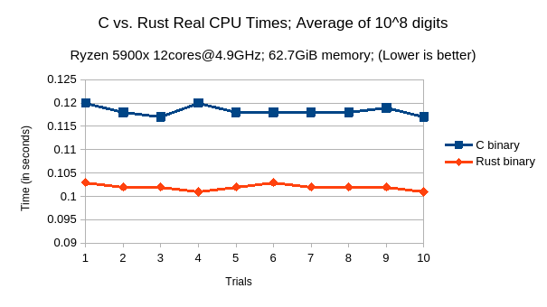
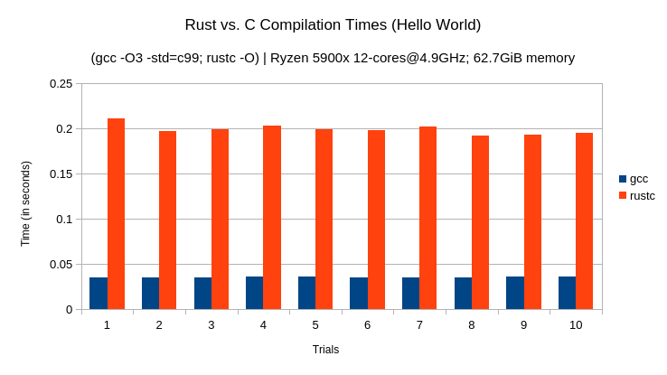

# Introduction
With it's debut in the 1970's, C has been known for it's declaration towards high-level, human-readable code
by setting what is essentially the gold standard of computional performance. However to achieve this efficiency, 
all guard rails towards **memory safety** had to be removed-- as C's programming interface works directly with 
managing memory at a high-level without cost towards low-level efficiency when compiling over to machine code. 
As a result, many software projects there-on would need to be reviewed for hours and hours just to have a 
single violation of memory access to occur deep into an extremely large codebase-- often causing the whole 
system to come crashing down.

To address this lapse of development speed due to hunting memory vulnerabilities in systems-- certain languages after C
would include what is known as **garbage-collection** in order to better address how memory is managed overall by including
some additional overhead to track, allocate, and delete bits of memory during run-time. However, this performance overhead
in certain scenarios can prove itself to be much more tedious to deal with, and largely memory inefficient-- causing spikes
in runtime performance due to the overhead of a garbage collector or **interpreter**. 

C's successor **C++** tried to make some abstractions to how memory is managed with the concept of 
*Resource Acquisition is Initialization* (**RAII** for short)[@raii], however C++ still runs into the same
issue of having to correctly adjust for memory vulnerabilities-- as the language still has to manually 
manage memory in certain cases.  

# Introducing Rust
In 2006, a Mozilla developer named Gordon Hoare decided that he would make a memory-safe language 
as a response to the software required to run his building's elevator failing when he was returning to 
his 21st floor apartment. Rust was developed as a response to the failures caused by manual memory management in
C/C++; however it wouldn't see a full 1.0.0 release until May 15th, 2015[@acm_klabnik_2016]. At the current time of writing this paper,
Rust is currently at release 1.100.0[@rust_github].

Rust was bootstrapped with OCAML and took a large inspiration from the language[@acm_klabnik_2016];
Mostly inheriting OCAML's emphasis on safety and it's algebraic data types, but also inheriting some features from 
other languages like Haskell, RAII from C++, Erlang, Swift, and C# just to name a few [@rust_influences]. But how does 
the language measure up to an industry titan like C?

## Benchmarks


As it turns out-- **Rust can run slightly faster than C**; But realistically stays within the same time bounds of C-- with a negligable
difference of a 1 to 2ms of runtime. These metrics demonstrate that Rust to run code at the performance of C with guarantees of memory-safety.

### Measuring Memory Safety
To analyze memory safety-- we can analyze the code used to generate the performance run-time used in data from the previous subsection as reference:

Written below is the Rust implementation that I had written:
```rust
const LARGE_NUMBER: usize = 100_000_000;
fn average(vec: &[usize]) -> f64 {
    vec.iter().sum::<usize>() as f64 / vec.len() as f64
}
fn main() {
    let mut one_million_digits: Vec<usize> = vec![0; LARGE_NUMBER];
    for i in 0..one_million_digits.len() {
        one_million_digits[i] = i + 1;
    }
    let result = average(&one_million_digits);
    println!("average= {result:.2}")
}
```
\newpage
and below is my C implementation for comparison:
```c
#include <stddef.h>
#include <stdio.h>
#include <stdlib.h>

#ifndef LARGE_NUMBER
#define LARGE_NUMBER 100000000
#endif

// defines the Vector Type which handles resizing and
// is heap allocated (just as it is in Rust.)
typedef struct Vector {
  size_t length;
  size_t capacity;
  size_t *buf;
} Vector;

// allocates a new array type
Vector vec_new() {
  size_t capacity = 2 * sizeof(size_t);
  size_t *buffer = (size_t *)malloc(capacity);

  Vector return_vec = {
      0,
      capacity,
      buffer,
  };
  return return_vec;
}
// reallocates the space for the vector-- retaining all values
void pushback(Vector *vec) {
  size_t newcap = vec->capacity * 2;
  vec->buf = (size_t *)realloc(vec->buf, newcap);
  vec->capacity = newcap;
}

// push a value to the vector
void vec_push(Vector *vec, size_t value) {
  if (vec->capacity == sizeof(size_t) * vec->length) {
    pushback(vec);
  }
  vec->buf[vec->length] = value;
  vec->length += 1;
}

double average(Vector *vec) {
  size_t sum = 0;
  for (size_t i = 0; i < vec->length; i++) {
    sum += vec->buf[i];
  }
  return (double)sum / vec->length;
}

int main(void) {

  Vector my_vec = vec_new();
  for (size_t i = 1; i <= LARGE_NUMBER; i++) {
    vec_push(&my_vec, i);
  }
  double avg = average(&my_vec);
  printf("average= %.2f\n", avg);
  free(my_vec.buf);
}
```
As we can see both code samples are relatively safe; But the C implementation has far more functionality included--
that is because my **C version needs to address potential memory vulnerabilities** that my Rust version does not.
Both implementations result in the exact same result; The results match even as we dive deeper into implementation
details such as using vector data structures in both C and Rust.

But how exactly is my Rust implementation safer?: The true answer is that it is **both not safer, and is safer**.
Akin to Schrodinger's Cat, it depends on how much code is necessary to add to make new features functionally correct, 
and only when certain conditions are met-- does the safety caused by Rust's **zero-cost abstractions** prove themselves
to be quite useful.

For example should I want to add more features to my program, Rust's development time would take far less time when compared to C due to
modern features in their developer ecosystem such as `cargo` and guarantees of memory safety with Rust's **Borrow Checker** and **Ownership Principles**. 
In C, should I want to add more features-- there exists only a dread of time spent making sure that all of my code is fit to the certain Standard
that I want to compile to, and ensuring that I-- the developer-- make no mistakes in my implementation.

\newpage


But my small little codebase isn't enough to account for real-world scenarios where Rust has actually made a difference. 
To address this, I would like to look at a report from Google in 2025 detailing the amount of vulnerabilities that
were reduced because of Rust. According to Jeff Vander Stoep, a developer on the Android Team at Google, Rust was
adopted to the Android Codebase as part of an initiative to reduce memory vulnerabilities. As a result, the team
saw **1000x less memory vulnerability density**, experienced a **4x lower rollback rate**, and spent **25% less time in code review** [@stoep_2025].

Google is not the only entity to adopt Rust for it's security principles. As a matter of fact, a few years earlier Bob Lord
the senior technical advisor to CISA (Cybersecurity and Infrastructure Security Agency) had also written about the need
for software to abide to secure-by-design (SBD) principles, and listed Rust as one of the potential languages to replace
C/C++ codebases [@lord_2023]. \newline Their initiative was to **remove all memory safety vulnerabilities** by urging companies to adopt several 
memory safe languages to companies' software development life cycle (SDLC).

This begs the question: How exactly does Rust perform at the Level of C without introducing the same memory vulnerabilities
as C/C++? The answer lies within the **Borrow Checker** and **Rust's Ownership feature**.


# The Borrow Checker and Ownership
The Borrow Checker is a part of Rust's ownership principles, and is what allows Rust to make guarantees to memory safety
without a garbage collector. What **ownership** is exactly is a set of rules to how a Rust program manages it's memory at compile-time 
to guarantee that the code is compiled to a **safe and efficient** binary [@rust_book].

## Rules of Ownership
1. Each value in Rust has an owner.
2. There can only be one owner at a time
3. When the owner is out of scope, the value is dropped.

### Demonstrating the Rules of Ownership
To best demonstrate this, let's look at some Rust code:
```rust
fn moved(x:i32)-> i32{
  let y = 12;
  x += y
  // y gets dropped because it is no longer in scope
}
fn main(){
  let a = 23; // a is the owner of this value
  let b = moved(a); // ownership of a gets transferred to moved().
  println!("{b}");
}
```
This simple sample of Rust code demonstrates all principles of ownership, but lets look a bit closer at it;
This program does one thing only: take the number 23 and add 12 to it, and then print the result. However,
under the hood a lot more is happening.

```rust
fn moved(x:i32)-> i32{
  // x is binded to a; ownership changes
  let y = 12; // y-------------|
  x += y      //               |
  // lifetime of y ends<------|
}
fn main(){
  let a = 23; // a ------------|
  let b = moved(a); //         | b -|
  // lifetime of a ends<-------|    |
  println!("{b}"); //               |
  // lifetime of b ends<------------|
}
```
Above is a rough illustration of what happens specifically **with stack allocated variables**,
which is simple enough to demonstrate how Rust handles these key principles of lifetimes.

**Lifetimes** are what drive the ownership principles of Rust to be able to efficiently manage
memory without having to rely on garbage collection. They layout the rules for what is acceptable
and what is not acceptable use of memory, and thus trigger a hard error when it encounters violations
of these principles at compile-time; This is very unlike C which will compile invalid code leading can lead to 
**dangling pointers**, and other **undefined behavior**[@c_lifetimes].

However, this increased safety does come with a cost...

## Increased Compilation Times


Pictured above is the total time spent in the CPU for the compilation of two identical programs written in both
C and Rust that just simply print "Hello World!", and exit. From the chart alone-- we see that Rust took **10x**
more time to compile in the CPU, and that's largely due to the complex nature of the **borrow checker** and 
**validating ownership principles**. This benchmark was performed on my workstation desktop running Arch Linux and 
powered by an AMD Ryzen 5900x 12-core chip, with 62.7GiB (64 GB) of RAM-- along with an NVIDIA RTX 3070 GPU.

Below this paragraph are the programs that were used in order to generate this benchmark:
\newpage

Rust:
```rust
fn main(){
  println!("Hello, World!");
}
```
C:
```c
#include <stdio.h>
int main(void){
  // ignore the fact a comma is missing; 
  // impact to compilation time is negligable.
  printf("Hello World!\n"); 
  return 0;
}
```
Visually, the code is identical; There are just a few caveats that are not visible until compilation.
To reiterate: Rust is doing work at compile time to ensure memory safety throughout the program, in addition
to ensuring that the provided syntax is correct. In contrast, C is doing only the latter of the process and
only ensuring that the syntax of a program is correct, with very little verification to ensure that no undefined
behavior can occur during runtime.


# Attempts to transliterate C-to-Rust
This section of my paper will look at ways that we can automatically transliterate C-to-Rust.
The primary portion of this section will look at linguistic similarities and differences in
both languages to discern whether or not it is possible to make **high quality Rust code**
without the use of AI, and to what advances the researchers using AI to transliterate are making.

## Addressing Linguistic Similarities and Differences
### Type System in C
In C there are only a few types in comparison to Rust. Sizes are implementation defined [@c99_standard],
but are defined by using the GNU C Compiler @ 64-bits :

### Signed Integers
- `char` (signed 8-bit integer)
- `short int` (signed 16-bit integer)
- `int` (signed 32-bit integer)
- `long int` (signed 64-bit integer)
- `long long int` (signed 64-bit integer)

### Unsigned Integers
- `unsigned char` (unsigned 8-bit integer) 
- `unsigned short int` (unsigned 16-bit integer)
- `unsigned int` (unsigned 32-bit integer)
- `unsigned long int / unsigned long` (unsigned 64-bit integer)
- `unsigned long long int/ unsigned long long` (unsigned 64-bit integer)
- `size_t` (implementation defined)

### Floating Point Numbers 
- `float` (32-bit floating point number)
- `double` (64-bit floating point number)
- `long double` (128-bit floating point number)

In addition, C has pointer-based structures known as **buffers**, which can store
any value of the above types into a statically allocated array on the stack contiguously.
Alternatively, you can use the standard library `<stdlib.h>` to dynamically allocate values 
upon the heap using `malloc()`, `realloc()`, and `calloc()`.

## Rust Types
In contrast, Rust has many more types included in the Standard Library in comparison to the C programming
language. As a result, not all types can be directly translated over to Rust using the traditional methods 
due to the sheer 

Below is a list of primitive types that Rust uses along with their associated C types (C99 standard) if applicable[@rust_book]:

## Scalar Types
### Signed Integers
- `i8`
> `char`/signed 8-bit integer
- `i16`
> `short int`/signed 16-bit integer
- `i32`
> `int`/signed 32-bit integer
- `i64`
> `long int`/`long long int`/signed 64-bit integer
- `i128`
- `isize` (architecture dependent)

### Unsigned Integers
- `u8`
> `unsigned char`/unsigned 8-bit integer
- `u16`
> `unsigned short int`/unsigned 16-bit integer
- `u32`
> `unsigned int`/unsigned 32-bit integer
- `u64`
> `unsigned long long int`/`unsigned long int`/unsigned 64-bit integer
- `u128`
- `usize` (architecture dependent)
> `size_t` (also architecture dependent)

### Character Type
- `char` (distinct from the C `char` type)

What makes char distinct from the C char type is that char must be defined
as a printable character in code and must be declared with single (`'`) quotation marks:

```rust
fn main(){
  let my_c:char = 'c';
  println!("{my_c}");
  let my_a:char = 'a';
  println!("{my_a}");
  let my_r:char = 'r';
  println!("{my_r}");
}
```
prints:
```
c
a
r
```

## Compound Types
- `Tuples`
- `Array`
> `Static Buffers in C`

## Collection Types
Below are a list of types that are defined as a part of the std::collections type which have no bindings in C,
and must be manually implemented:

- `Vec<T>`
- `Hashmap<K,V>`

## Typecasting
Both languages allow type casting. Something interesting is that both languages support
casting into smaller types; However let us note some nuances:

\newpage
I wrote the following code in Rust and annotated points of interest with \newline comments:
```rust
/* main.rs */
fn test(a: u16) {
    let b: u16 = 12;

    let c = a + b;
    println!("value of c: {}", c) // POI 2
}

fn main() {
    let t: u64 = u64::MAX;
    println!("value of short cast: {}", t as u16); // POI 1
    test(t as u16);
}
```
> This will compile correctly, yet there is some incorrect behavior that exists,
Let's see how Rust handles it...

### POI 1: 
Let's start with casting to a smaller type within a `print` statement.
When we reach this point in execution, the program will just cast it to
the maximum of `u16`; which is 65535.

### POI 2:
This is where things get interesting, because the behavior changes depending on compiler options.
If you are compiling normally with the following compiler options:
```sh
rustc main.rs
```
The attempted addition into point c above this line will cause the program to crash.
However, if you are compiling with optimizations:
```sh
rustc -O main.rs #similar to gcc -O3 
```
The program will run and reach this point effortlessly. This is because the debug symbols when
compiling **without** the compiler option will detect that we are trying to fit a larger sized integer
(64 bits) into a smaller integer size (16-bits). However, with the optimizations enabled; Rust performs
two's compliment and wraps the number around to `u16::MAX`; giving the result 11 (number resets to 0).

\newpage
We can view the exact same behavior in the C equivalent:
```c
#include <limits.h>
#include <stdio.h>

void test(unsigned short int a) {
  unsigned int b = 12;
  unsigned int c = a + b; // cast into smaller digit size...
  printf("value of c: %hu\n", c); // print the result
}

int main(void) {
  unsigned long long int x = ULLONG_MAX;
  printf("value of short cast: %hu\n", x);
  test(x);
}
```

With both programs outputting:

```
value of short cast: 65535
value of c: 11
```

# Rust specific complications
This section I talk about the specific complications that are difficult to deal with in transliterations,
particularly with the behavior of Rust.


## Variable mutability
Mutability just means that the variable can be changed. In Rust, we define a variable to be mutable with the
`mut` keyword, which allows a variable to change its value. In C, all variables are mutable.

An immutable variable differs from the `const` keyword in Rust because `const`s cannot be derived from 
variables, as these are compiled directly into the program.

For example:

```rust

const COOL_NUMBER: i32 = 123;
fn addcool(x:i32)-> i32{
    let y = x + 32;
    x + COOL_NUMBER + y
}
fn main(){
    let mut x = 2;
    x = addcool(x);
}
```
The number `123` is actually compiled into the program and cannot be changed at all; `const` keywords dictate a promise to the
compiler that the number will not be changed at any point during execution, and will remain the same value throughout.

## Implicit Returns
Unlike C, Rust does not require the `return` keyword when at the end of a function.
We can do this by just removing the semi-colon and returning an expression.

```rust
fn add2(x:i32)->i32{
    x + 2 // implicit return 
}

fn main(){
    let x = 21;
    let y = add2(x); // y = 23
}
```
A direct translation in C would be:
```c

int add2(int x){
    return x + 2;
}

int main(void){
    int x = 21;
    int y = add2(x); // y = 23
}
```
While this example is easy to understand, let's look at some more advanced Rust:
```rust
fn between_three_options(mut x:u8)-> u8{
    x += 1;
    match x{
        1=> 132,
        2=> 240,
        3=> 56,
        _=> 0,
    }
}

fn main(){
    let x = 2
    let y = 3
    let z = between_three_options(x); // z = 56
    let a = between_three_options(y); // a = 0
}
```
This code would be the equivalent of:

```C
#include <stdio.h>
unsigned char between_three_options(unsigned char x) {
    switch (x += 1) {
    case 1:
      return 132;
      break;
    case 2:
      return 240;
      break;
    case 3:
      return 56;
      break;
    default:
      return 0;
      break;
    }
}
int main(void) {
    unsigned char x = 2;
    unsigned char y = 3;
    unsigned char z = between_three_options(x);
    unsigned char a = between_three_options(y);
}
```

The code is nearly identical with the caveat of the implicit return type in Rust.
This is because the result of the match statement stores the value of the internal
enumeration after it has found it's 'match point' and it determines the value that is
returned; using a jump table to return the correct answer.

In C, we must use the `switch` statement which is the operates the exact same; however
we need to know when something is an explicit return because the answer must be enumerated within
that jump table-- or if the code needs to refer to the continuation of the program rather than explicitly
return an error-- which is where the problems arise.

### Explicit Errors
In C, you would have to determine what value is considered an "error value" and check externally from the function
whether that value is reached at any point. In Rust you can use the `Result<V,E>` Enumeration:
```rust
use std::error::Error;

fn between_three_options(mut x:u8)-> Result<u8, &'static str>{
    x += 1;
    match x{
        1=> Err("Value is 3 numbers too low"),
        2=> Err("Value is 2 numbers too low"),
        3=> Err("Value is 1 numbers too low"),
        _=> Ok(0)
    }
}

fn main()-> Result<(), Box<dyn Error>>{
    let x: u8 = 0;
    let a = between_three_options(x)?; // would result in an error and 
                                       // exit with an error message.
    let b = between_three_options(5)?; // b would store Ok(0); but is 
                                       // unreachable.
    println!("b value= {}", b);
  Ok(())
}
```
Where as something like this in C would require more error handling:
```C
#include <stdio.h>
unsigned char between_three_options(unsigned char x) {
    switch (x += 1) {
    case 1:
      fprintf(stderr,"Value is 3 numbers too low")
      exit(1);
      break;
    case 2:
      fprintf(stderr,"Value is 2 numbers too low")
      exit(1);
      break;
    case 3:
      fprintf(stderr,"Value is 1 numbers too low")
      exit(1);
      break;
    default:
      return 0;
      break;
    }
}
int main(void) {
    unsigned char x = 0;
    unsigned char a = between_three_options(x);
    unsigned char b = between_three_options(5); // code is unreachable
}
```
The difficulty is not implicit to implementation details, but rather to syntax and behavior.
In certain cases; Rust can simplify C code down to it's most abstract levels; as is removing
the need to implicitly exit each time we reach an unrecoverable error.

## Generics and Polymorphic Behavior
Generics are something that are exclusive to Rust, and are what allow it to perform polymorphic behavior.
The best way to exemplify this is with the `Vec<T>` type which create a struct of type `T` which is a generic.

For example, you can have `Vec<f64>`, or `Vec<u32>`, or even `Vec<Vec<u8>>`; This is because generics allow
different ways to implement the same functionality for different types, which is how Rust achieves 
**polymorphic behavior**. 

This is relevent to us mostly because it is way more difficult to implement polymorphic behavior in C,
but also because this is something that is unique to Rust and is something that cannot be determined how
to transliterate directly.

## Dealing with Structs
In both C and in Rust, you may define customized data structure types with the `struct`
keyword. Structs typically hold primitive types such as the all of the types above or another
`struct` value. However, a C struct and Rust struct both differ completely. The best way to
exemplify this is by analyzing how a struct works in Rust.

In Rust, structs demonstrate OOP-like principles in their design. As an example, I wrote
the following program to create a simple Cartesian Graph:
```rust 
use std::fmt::Display;
struct Point {
    pub x: f64,
    pub y: f64,
}
impl Point {
    pub fn new<T: Into<f64>, U: Into<f64>>(new_x: T, new_y: U) -> Point {
        //! creates a new point.
        Point {
            // we use generics to convert both x and y into f64 points.
            x: new_x.into(),
            y: new_y.into(),
        }
    }
    pub fn mid_point(&self, other_point: &Point) -> Point {
        //! calculate the mid point and return it as a new point.
        let mid_x = (self.x + other_point.x) / 2_f64;
        let mid_y = (self.y + other_point.y) / 2_f64;
        Point { x: mid_x, y: mid_y }
    }
}
/// Makes the point printable.
impl Display for Point {
    fn fmt(&self, f: &mut std::fmt::Formatter<'_>) -> std::fmt::Result {
        write!(f, "({}, {})", self.x, self.y)
    }
}
fn main() {
    // since we use generics to convert it into an f64,
    // we can use integers instead of casting into 64-bit 
    // floating point numbers.
    let p1 = Point::new(-1, 2);
    let p2 = Point::new(3, 4);
    let p3 = p1.mid_point(&p2);

    println!("value of p1: {}", p1);
    println!("value of p2: {}", p2);
    println!("value of p3: {} # midpoint", p3);
}
```
We can see that this implementation does some relatively advanced things;
but what we're mostly focused on is the syntax used, particularly:
```rust
    //...
    let p3 = p1.mid_point(&p2);
    //...
```
This piece of code uses Rust's Object-Oriented like programming syntax to be able
to calculate and return the midpoint from the referenced 2nd point `p2` with the values
used for `p1` as defined in the function on line 15 (`mid_point(&self, other_point: &Point)-> Point`).

This type of syntax while possible in C, is extremely hard to reproduce-- as it would require using
pointers to functions in order to be able to call values. It would be much easier to write a function
that dictates how to calculate the midpoint as written in my translated version below:
```c
#include <stdio.h>
#include <stdlib.h>
typedef struct Point {
  double x;
  double y;
} Point;

Point midpoint(Point *first_point, Point *second_point) {
  // calculate the midpoint
  double new_x = (first_point->x + second_point->x) / 2;
  double new_y = (first_point->y + second_point->y) / 2;
  Point midpoint = {new_x, new_y};
  return midpoint;
}

char *str_point(Point* point) {
  // print the string representation of a Point
  char *string = (char *)malloc(10 * sizeof(char));

  sprintf(string, "(%.2lf, %.2lf)", point->x, point->y);
  return string;
}

int main(void) {
  Point p1 = {-1, 2};
  Point p2 = {3, 4};
  Point p3 = midpoint(&p1, &p2);
  // get the string representations.
  char *p1_string = str_point(&p1);
  char *p2_string = str_point(&p2);
  char *p3_string = str_point(&p3);
  // print the values
  printf("value of p1: %s\n", p1_string);
  printf("value of p2: %s\n", p2_string);
  printf("value of p3: %s\n", p3_string);
  // free the strings...
  free(p1_string);
  free(p2_string);
  free(p3_string);

  return 0;
}
```
As we can observe in the code above, C doesn't really have much object-oriented principles implemented in the language;
with the exception of field accessors which were not implented in the program, but would look similar to:
```c
#include <stdio.h>
typedef struct Point {
    double x;
    double y;
} Point;
int main(void){
    Point p1 = {1, 2};
    printf("x: %lf, y: %lf", p1.x, p1.y);
}
```
## Unsafe Rust
Unsafe Rust is Rust that allows for the existence of contracts that the Rust compiler cannot check.
However, it does not mean that it can cause undefined behavior unlike C which will cause undefined behavior;
which is referred to by the Rust language as **soundness** [@rust_reference].

Meaning that no matter what, we will always be able to remove undefined behavior.

## No pointers in Rust
As we see in the code above, pointers in C need to be translated into referenced variables
with types which defaulting to using a function is a little bit tedious when it comes to
heap allocated objects-- as we would need to perform unsafe Rust.

## Issues
To summarize, transliterating C to Rust would be difficult because of the following reasons:

1. Direct translations while correct, are just gross misrepresentations of the abstractions that Rust provides.
This is because `structs` in Rust are similar to C structs, but represent their own version of what a class is in object-oriented languages. 
The object-oriented like syntax of Rust makes it possible to have simplified versions of what C implementations define into their own object 
and thus deriving methods from derived functions can prove themselves to be difficult to translate effectively.
2. Rust's generic system allows developers to build complex programs that exhibit polymorphic behavior that otherwise would be difficult to
translate from C.
3. Pointers make understanding what counts as verifiable proper behavior of a program difficult because
the behavior in Unsafe Rust is vastly different than to what it is in C; Therefore projects that rely
on finding such undefined behavior at run-time can be provingly difficult to translate because certain
abstractions in Rust make these nearly pointless to transliterate-- or require a different solution overall.

\newpage
## C2Rust
C2Rust is an Open-Source project designed to perform static analysis over C code in order to
produce working Rust Code[@c2rust]. This project appears in many other research papers performed
by other academics in order to refine translated C code to more efficiently handled Rust code.

However, C2Rust has some short comings. Researchers at the University of Science and Technology in China
found that the transpiler "does not significantly improve the safety of programs" and do not address how to 
properly abstract C code directly into Rust[@lei_xia_empirical_2023]. As a result, other researchers sought to
use Large Language Models (LLMs) to refine the output produced by C2Rust in order to increase the safe output
of C2Rust[@sirlanci_c2rust-bench_2025]. A research enclave in China had also developed their own LLM powered transpiler to
produce memory-safe transpilations from C2Rust with their own model: *SpeC2Rust* [@yao_spec2rust_2026].


## TRACTOR and Advances with Artificial Intelligence
TRACTOR is an acronym for Darpa's project to **TR**anslate **A**ll (legacy) **C** **TO** **R**ust [@tractor].
The project started in late 2024 when they announced the initiative[@darpatv_tractor_2024]. The program is 
designed to automate the translation of C code to Rust-- to the same quality of an experienced Rust developer.

As we have seen in the previous section-- this is a very difficult task to achieve. However, researchers at
MIT Lincoln Labs have published their own benchmarks for an early model, which releases a benchmark every six
months to guide program performers[@mit_tractor].


\newpage
# My own proposal: Mnemosyne
Due to time constraints set on getting this paper out, my project Mnemosyne has been put on a
pause. However, should I want to return to getting a demo model released; the following section
explores how I would approch it.

## Theoretical Model of how it would work
Mnemosyne would be composed of several different modules, but primarily composed of:

- Static Analyzer
- Refiner
- Tester

1. A basic **static analyzer** will process C keywords, functions, and return types across a C codebase and
use header files to determine which files are to be transpiled to Rust modules.
2. A second run of the analyzer will occur searching for structs and functions that call and define
the implementation of these structs into Rust.
3. Once the analyzer is complete, a basic Rust package is produced containing all direct transliterations
of each file, and their responding directories are made.
4. A process of refinement will occur through the **refiner**, which will look at each module and function call
to attempt and reduce these functions into abstract methods and types friendly to the Rust ecosystem.
5. A working binary will be produced, and tested against using the **tester module**, which will implement 
test functions in a generated shell script to ensure that cases that are defined in a configuration 
file written in `toml` are tested against.


\newpage
# Bibliography
